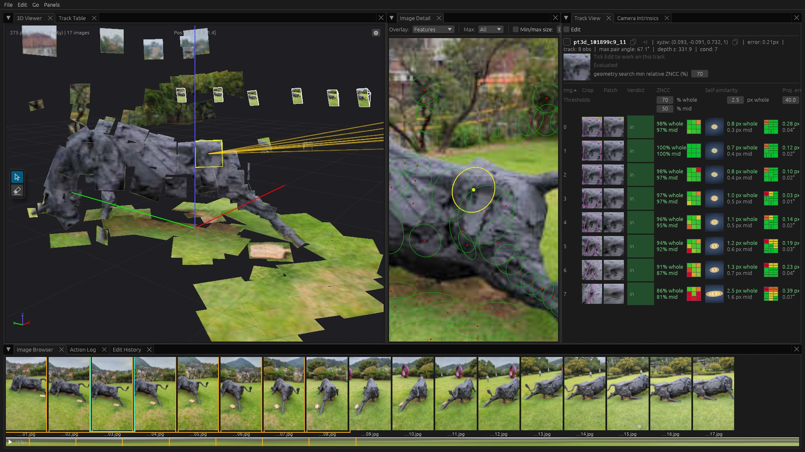

# The Structure from Motion Tool

SfM Tool is a command-line toolkit (`sfm`) and a desktop viewer (SfM Explorer). It builds
Structure from Motion reconstructions from photographs and shows them in 3D.

SfM Tool builds heavily on the work of others, especially [COLMAP](https://colmap.github.io/)
and [OpenCV](https://opencv.org/). Most of what it does differently is in the workflow you use
to create SfM reconstructions.



## About this Project

The goal of this project is to make creating and exploring Structure from Motion (SfM) fun.
I had a bunch of vacation datasets of interesting scenes sitting around, ready for photogrammetry and
Gaussian splats, but using existing tools wasn't as fun as I imagined it could be. I
also wanted a project for learning agentic AI coding tools with no expectations
or restrictions. The result is this project, and I hope you enjoy it if you give it a try!

## What is Structure from Motion?

In SfM, you take photographs of a static scene from multiple different poses.
Importantly, take them from different positions around the scene, not by turning around
in one position. Starting from just
the photographs, the SfM solver estimates the structure of the scene and the motion of the
camera at the same time. The structure is a set of 3D points on surfaces that are visible from
more than one camera. The motion is each photo's camera position and orientation. The solver
also estimates each camera's intrinsics, such as focal length and lens distortion.

Recent research is focused on ideas like using feedforward networks to go straight from images
into 3D representations. This project is not about VGGT or similar techniques, but visualizing their
output in SfM tool or using them as part of SfM would be interesting to explore.

## Installation

```
pip install sfmtool
```

Wheels are published for Python 3.14 on x86-64 Linux, x86-64 Windows and Apple silicon
macOS. Anywhere else, including Intel macOS, pip builds sfmtool from the source distribution.
That build needs a Rust toolchain at version 1.98 or newer.

## The workflow

Three commands make a reconstruction and show it. Run them in a directory that
has your photographs in `images/`:

```
sfm ws init                     # make the directory a workspace
sfm solve -g images/            # solve the photographs into a .sfmr file in sfmr/
sfm explorer sfmr/<file>.sfmr   # view it in SfM Explorer
```

Start with [Getting Started](tutorials/getting-started.md), which runs these
on 85 example photographs and shows what each prints.

## About Mark Wiebe

I'm Mark Wiebe, and I've long had a soft spot for everything to do with capturing, reconstructing,
and rendering 3D. This is a personal project, all views are my own and do not reflect Amazon's
views or positions. I work as a Principal Engineer at AWS on the [Deadline Cloud](https://aws.amazon.com/deadline-cloud/)
web service that provides render farm/batch computing focused on rendering and related workloads.
Other projects I've helped create include the [conda package management system](https://conda.org/)
while building the [Anaconda Distribution](https://www.anaconda.com/download), introducing the
[einsum](https://numpy.org/doc/stable/reference/generated/numpy.einsum.html) function to NumPy, and
I played a major role creating tools at [Frantic Films](https://en.wikipedia.org/wiki/Frantic_Films)
and at [Thinkbox Software](https://aws.amazon.com/media-services/thinkbox/) (later acquired by AWS) such as
Deadline, Flood, Krakatoa, XMesh, Frost, Sequoia and more.
