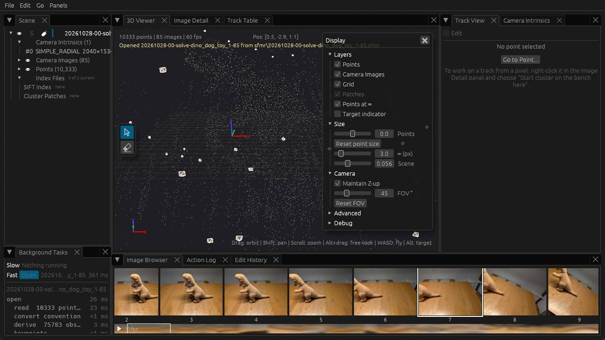
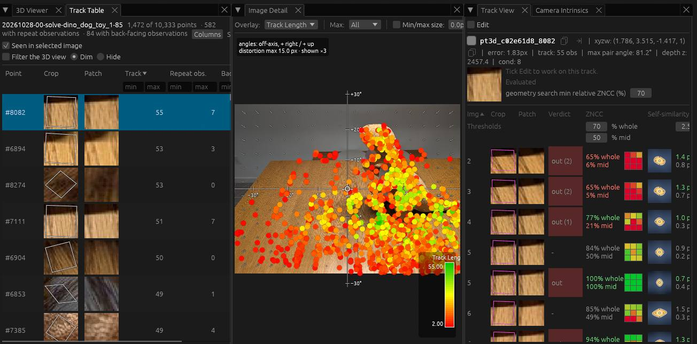
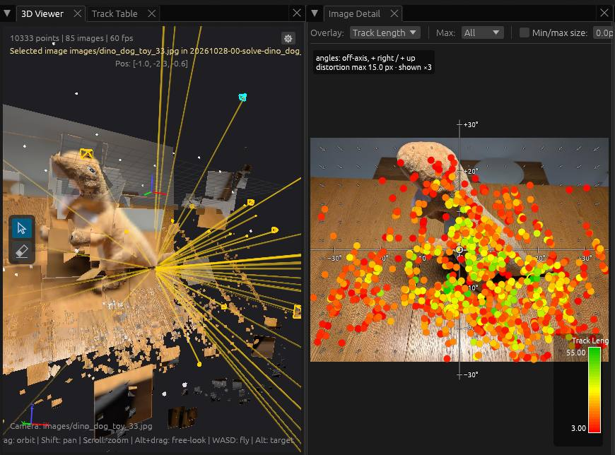
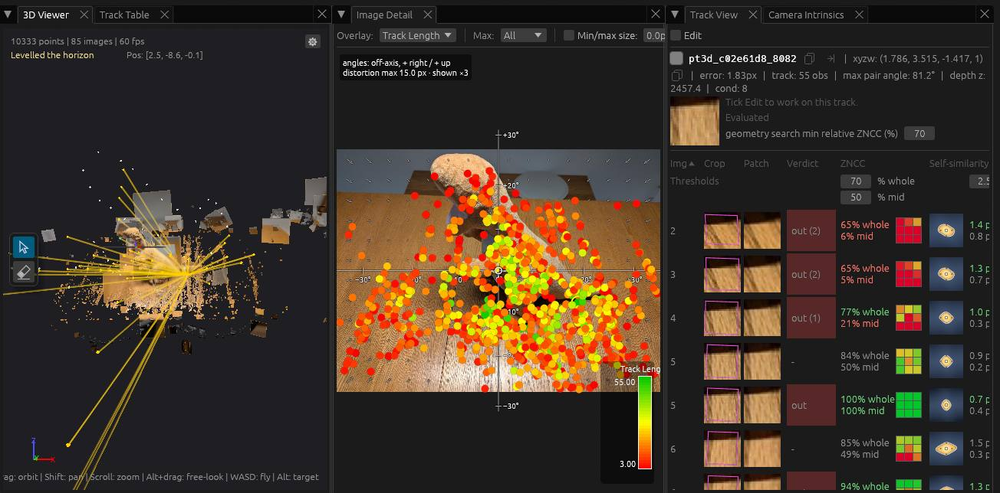
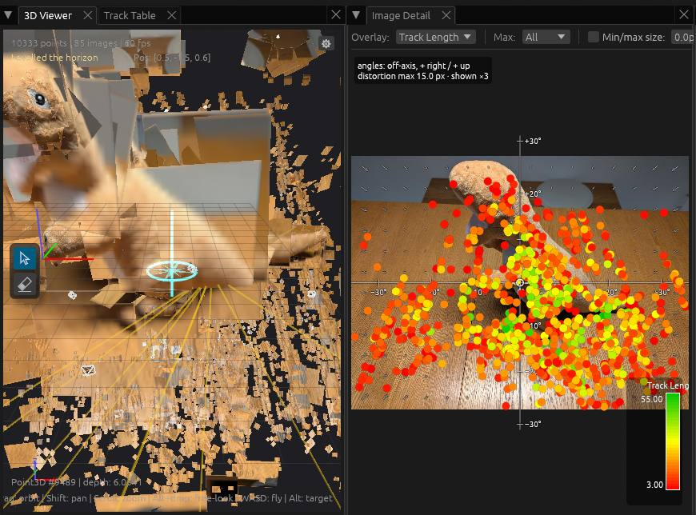

# Getting Started

## Quickstart

With a good set of photographs, use SfM Tool to create and view a sparse
reconstruction in a few steps. This uses COLMAP and GLOMAP under the hood.

We'll use the [dino dog toy dataset](https://github.com/sfmtool/sfmtool/tree/main/test-data/images/dino_dog_toy)
— 85 photographs of a dog toy taken from different angles. The table and the
toy have texture detail that gives a rich set of SIFT features for the solve.

### 1. Install and set up

```
$ pip install sfmtool
```

Create a workspace directory and copy your images into it.

```
$ mkdir -p dino/images
$ cp path/to/dino_dog_toy/*.jpg dino/images/
$ cd dino
```

### 2. Initialize the workspace

```
$ sfm ws init --max-features 4000
Initialized workspace: .../dino
Configuration file: .../dino/.sfm-workspace.json
  feature_tool: sfmtool
  contrast_threshold: 0.0067
  octave_layers: 3
  max_num_features: 4000
```

### 3. Solve

Run the global SfM solver (GLOMAP). This automatically extracts SIFT features,
matches them across images, and solves for camera poses and 3D structure.

```
$ sfm solve -g images/ --max-features 2000
Running global SfM with GLOMAP...
Image files:
  .../dino/images/dino_dog_toy_%02d.jpg (85 files, sequence 1-85)
...
Found reconstruction 0:
  Cameras: 1, Images: 85, Points: 10580
Saved reconstruction to: .../dino/sfmr/20260413-00-solve-dino_dog_toy_1-85.sfmr
Completed in 1m 4.75s
```

### 4. Explore in 3D

Open the reconstruction in the SfM Explorer GUI by giving it the `.sfmr` file
the solve wrote to the `sfmr/` directory.

```
$ sfm explorer sfmr/20260413-00-solve-dino_dog_toy_1-85.sfmr
```

!!! note
    SfM Explorer is part of the PyPI package from sfmtool 0.3, so `sfm
    explorer` works after `pip install sfmtool`. The 0.2 package does not
    include it; with 0.2, run the viewer from a source checkout with
    `pixi run gui`. Its automated window tests run on Windows, macOS and
    Linux, but most hands-on use has been on Windows. On Linux it needs a
    Vulkan driver.



## Converting Video to Image Sequences

To try many different things with a particular 3D reconstruction, having the
data as a video complicates individual frame access. Therefore the `sfm` command expects you
to always convert to images first.

Here's an example of using [ffmpeg](https://www.ffmpeg.org/) to convert a
single video in the current directory into a sequence of images in a `frames`
subdirectory:

```bash
# Assumes there's one video in the current directory
VIDEO_FILE=$(echo *.mp4)

IMAGE_BASE=$(basename "$VIDEO_FILE")
IMAGE_BASE=${IMAGE_BASE%.*}

mkdir -p frames
ffmpeg -i "$VIDEO_FILE" \
    -qscale:v 2 \
    frames/"${IMAGE_BASE}_%04d.jpg"
```

## Viewing 3D Point Tracks

A point track connects a 3D point to its observations, the places where it
was seen in the photographs. Exploring tracks shows how SfM links features
across photographs. These steps start from the quickstart's reconstruction,
open in SfM Explorer.

### 1. Convert to embedded patches

Track View measures each observation against a small square of the surface,
the point's patch, and a fresh solve has no patches yet. In the **Scene**
panel, right-click the reconstruction's row, named after its file
(`20260413-00-solve-dino_dog_toy_1-85`), and choose **Convert to Embedded
Patches**.

The 3D Viewer's status line reads *Converted 20260413-00-solve-dino_dog_toy_1-85
to embedded patches: … points framed, 85 images read*, the row's name
gains a leading `*` for an unsaved change, a **Patches** row appears under it,
and the 3D view draws the patches as small squares of photograph. The change is held in the viewer;
**File > Save** writes it to the file.

### 2. Put Image Detail beside Track View

In the stock layout, **Image Detail** is a tab behind the **3D Viewer**, and
**Track View** is on the right. Drag the **Image Detail** tab into the middle
of the 3D Viewer; five square drop targets appear there in a cross. Release
it on the right-hand one to split the area.

The 3D Viewer is now on the left, Image Detail in the middle and Track View on
the right.

### 3. Look through a photograph

In the **Image Browser** at the bottom, double-click the thumbnail numbered
**2** to look through it. The Image Browser numbers images from 0 and the file
names count from 01, so this is `dino_dog_toy_03.jpg` (camera image 2).

The 3D Viewer's status line reads *Looking through
images/dino_dog_toy_03.jpg*, the 3D view shows the photograph from where its
camera stood, and Image Detail shows the same photograph.

In Image Detail's toolbar, set **Overlay** to **Track Length**. Each feature
with a track becomes a dot coloured by how many observations its track has,
from red for the shortest through yellow to green for the longest, and a
**Track Length** colour bar at the bottom right gives the range.

### 4. Select the longest track in the photograph

Click the **Track Table** tab, beside the 3D Viewer tab. Tick **Seen in
selected image**, so that the table lists only the points seen in
`dino_dog_toy_03.jpg`. Click the **Track** heading twice to sort by track
length, longest first (the first click sorts shortest first, and the heading
then shows a downward triangle). Click the top row to select its point.

The row turns blue, and Track View's header shows the point's ID and ends
with *track: N obs*, where N is the number in the row's **Track** cell.



Track View lists one row per observation. Its columns are **Img** (the camera
image index), **Crop** (the photograph around the patch), **Patch** (that
patch drawn square), **Verdict**, **ZNCC** (how closely this
photograph's view of the patch matches the point's stored patch), **Self-similarity**, **Proj. err** (the reprojection error, in
pixels over degrees), **Shift**, **Zoom**, **Reference**, **Status** and
**Name** (the file name); scroll sideways to see them all.

*N obs* counts observations, not photographs. One photograph can hold more
than one observation of the same point, which a GLOMAP solve can produce, so
the same **Img** number can appear on two rows. The Track Table's **Repeat
obs.** column, next to **Track**, counts those extra observations.

### 5. Navigate in camera view

Click the **3D Viewer** tab. It is still looking through camera image 2, and
draws the selected track as lines from the point to each camera that sees it.
With the pointer over the 3D Viewer:

- **Drag** to look around (free look) from the camera's position.
- **Scroll** (on a trackpad, pinch, or hold Ctrl and drag two fingers) to zoom
  the field of view in and out.
- **`.`** / **`,`** look through the next / previous camera image, keeping
  the direction you turned to.
- **Z** looks straight through the selected camera image.
- **Click** a camera frustum to select its camera image, which shows it in
  Image Detail; **double-click** it to look through it.

These keep camera view: the status line reads *Looking through …* after a
double-click or Z, and *Selected image …* after `.`, `,` or a click.



### 6. Navigate freely

Hold Shift and drag (on a trackpad, hold Shift and drag two fingers) to pan. A pan moves
the camera, so it leaves camera view, and the photograph behind the points
disappears. A plain drag now orbits around the target, a point in front of the
camera, and scrolling moves toward or away from it. With the pointer over the
3D Viewer, these keys fly through the scene:

- **W / S**: fly forward / back
- **A / D**: fly left / right
- **R / F**: fly up / down
- **Q / E**: tilt the horizon left / right. This turns **Maintain Z-up** off
  (in the **Camera** section of the 3D Viewer's **Display** box), and the
  status line reads *Maintain Z-up off*.
- **Home**: level the horizon (*Levelled the horizon*); **Shift+Home** resets
  the view.
- **Z**: zoom to fit all the points, or, while a camera image is selected,
  look through it.



Orbit and fly until the track's lines all show, as in this screenshot.

### 7. Move the target

Hold Alt and drag to look around from where the camera stands: the target
moves around the camera instead of the camera around the target. While Alt is
held the target is drawn as a compass, with a spike pointing up. Alt+click
sets the target to the point under the pointer and selects that point, and
Alt+scroll pushes the target away or pulls it closer.

To keep the target shown, open the **Display** box at the top right of the
3D Viewer (click its gear if it is closed) and tick **Target indicator** under
**Layers**. The status line reads *Target indicator on*, and the compass stays
drawn without Alt.



Orbiting turns around the compass's up spike. If the table looks tilted
against the compass, press Q or E to tilt the horizon until the compass lies
flat on the table; orbiting is then more comfortable.

## Inspecting a Reconstruction

### 1. Reconstruction summary

Use `sfm inspect -v` to get a detailed summary of a reconstruction from the
command line. Even from the command line, you can get an idea about the 3D
points from this output. The bounding box extents are accompanied by histograms
that show the point density projected to each axis. Similarly, you can see a
histogram of the reprojection error, track lengths, and 3D distance to the
nearest other point. (Without `-v`, `sfm inspect` prints a one-screen summary.)

```
$ sfm inspect -v sfmr/20260413-00-solve-dino_dog_toy_1-85.sfmr

Reconstruction file: 20260413-00-solve-dino_dog_toy_1-85.sfmr
======================================================================

Metadata:
  Operation: sfm_solve
  Tool: glomap
  Tool version: unknown
  Timestamp: 2026-04-13T20:35:01.368085-07:00

Workspace:
  Absolute path: C:\Dev\dino-test
  Relative path: ..
  Resolved workspace: C:\Dev\dino-test
  Feature tool: sfmtool

Reconstruction summary:
  Images: 85
  Thumbnails: yes
  Patch bitmaps: no
  Image paths:
    images\dino_dog_toy_%02d.jpg (85 files, sequence 1-85)
  Cameras: 1
  3D points: 10580
  Observations: 80387
  Avg observations per point: 7.60

Cameras:
  Camera 0: SIMPLE_RADIAL 2040x1536
    Parameter                      Value
    --------------------  --------------
    focal_length             1472.560231
    principal_point_x        1020.000000
    principal_point_y         768.000000
    radial_distortion_k1        0.021340

Rig configuration: none

3D Point statistics:
  Position range:
    X: [-14.750, 31.935]
    X distribution:
      ▁    ▁ ▁    ▁▁▁▁▁▁▂▅█▆▄▂▁▁▁▁▁▁▁▁▁▁▁▁▁▁  ▁▁▁▁              ▁    ▁
      -14.750                                                   31.935
    Y: [-6.598, 15.843]
    Y distribution:
      ▁  ▁▁▁  ▁▁▁▁▁▁▁▁▁▂▃▆█▆▄▅▇▇▅▁▁▁▁▁▁           ▁         ▁▁▁ ▁ ▁▁▁▁
      -6.598                                                    15.843
    Z: [-7.850, 14.627]
    Z distribution:
      ▁    ▁▁ ▁▁▁▁▁▁         ▁▁▁▁▂▆█▇▅▃▂▃▃▂▁▁▁▁▁      ▁▁▁▁▁▁▁▁▁▁▁▁▁▁ ▁
      -7.850                                                    14.627
  Reprojection error:
    Mean: 1.165 pixels
    Median: 1.152 pixels
    Min: 0.045 pixels
    Max: 3.912 pixels
    Error distribution:
      ▁▁▁▁▁▂▂▃▃▄▅▄▆▆▆▇▇▇▇█▆▆▆▆▅▄▄▃▃▂▂▁▁▁▁▁▁▁▁▁▁▁▁▁▁▁▁▁▁▁▁▁▁  ▁   ▁  ▁▁
      0.045                                                      3.912

Observation statistics:
  Min observations per point: 2
  Max observations per point: 58
  Median observations per point: 5
    Track length distribution:
      ▁█▄▂▁▁▁ ▁▁▁▁▁▁▁ ▁▁▁▁▁▁▁ ▁▁▁▁▁▁▁ ▁▁▁▁▁▁▁ ▁▁▁▁▁▁▁ ▁▁▁▁▁▁▁ ▁▁▁ ▁▁ ▁
      2.000                                                     58.000

Nearest neighbor distances:
  Min: 0.000000
  Max: 5.487719
  Mean: 0.037203
  Median: 0.024898
    NN distance distribution:
      █▁▁▁▁▁▁▁▁▁▁ ▁▁      ▁      ▁     ▁             ▁               ▁
      0.000                                                      5.488

Completed in 0.04s
```

### 2. Image reprojection statistics

The `sfm analyze --metrics` report shows per-image reprojection error
statistics, sorted by mean error descending. Each row includes a histogram of
that image's error distribution, plus the observation count, mean track length,
and a flag for images with elevated error.

```
$ sfm analyze --metrics sfmr/20260413-00-solve-dino_dog_toy_1-85.sfmr

Per-image metrics analysis for: 20260413-00-solve-dino_dog_toy_1-85.sfmr
====================================================================================================
Reconstruction: 85 images, 10,580 points, 80,387 observations
Mean reprojection error: 1.165 px (median: 1.152 px)
Flagged images: 1 elevated-error

Image (by mean error desc)                           Obs   MeanErr    MedErr    MaxErr  MeanTL  Flag
----------------------------------------------------------------------------------------------------
images/dino_dog_toy_15.jpg                          1176     1.764     1.593     4.312    17.8  !
      ▁▂▃▃▅▅▅▆▇▆▆▆▆▇▇█▇▅▆▅▂▅▄▃▃▃▄▂▄▂▂▁▁▃▂▂▂▁▁▁▁ ▁
images/dino_dog_toy_16.jpg                          1036     1.710     1.539     4.005    15.7
      ▁▁▂▄▄▅▅█▅▅▅▄▄▄▄▅▃▄▃▄▃▂▃▂▄▃▂▂▃▁▁▂▂▂▂▁▁▂▁▁
images/dino_dog_toy_43.jpg                          1076     1.692     1.572     4.161    17.0
      ▁▁▁▄▃▅▄█▅▄▄▄▃▄▂▃▃▃▄▄▃▃▃▃▂▂▂▂▂▂▂▁▁▁▁▁▁▁▁▁▁
images/dino_dog_toy_34.jpg                          1071     1.638     1.491     4.293    16.8
      ▁▂▄▆▆▆█▆▅▇▅▅▆▅▅▆▅▆▅▄▃▃▄▃▃▂▃▄▂▂▂▂▂▂▂▂▁▁▁   ▁
images/dino_dog_toy_44.jpg                           846     1.616     1.434     4.128    16.6
      ▁▁▂▃▄▅▅█▆▅▃▃▄▃▃▃▄▃▃▃▃▄▃▃▂▂▃▁▂▁▁▁▁▁▁▁▁▁▁▁▁
...
images/dino_dog_toy_26.jpg                           865     0.882     0.659     3.936    14.4
      ▁▄▆▇▇█▇▅▃▄▃▂▁▂▁▁▁▁▁▁▁▁▁▁▁▁▁▁▁▁▁▁▁ ▁▁▁▁▁
images/dino_dog_toy_25.jpg                          1056     0.878     0.691     3.879    14.3
      ▁▅▆▆█▇▆▅▆▄▃▂▂▁▁▁▁▁▁▁▁▁▁▁▁▁▁▁▁▁▁▁▁▁▁▁▁▁▁
----------------------------------------------------------------------------------------------------
      0                                              5.1 px
!!  mean error > 2.305 px (2x reconstruction median of 1.152 px)
!   mean error > 1.729 px (1.5x reconstruction median of 1.152 px)
--  no observations (image registered but no points)
MeanTL = mean track length (avg number of images observing each point)

Completed in 0.10s
```

### 3. Depth range per image

The `sfm analyze --z-range` report shows the range of 3D point depths as seen
from each camera, with a histogram of the depth distribution.

```
$ sfm analyze --z-range sfmr/20260413-00-solve-dino_dog_toy_1-85.sfmr

Z range statistics for: 20260413-00-solve-dino_dog_toy_1-85.sfmr
======================================================================
Images: 85
3D points: 10580
Histogram buckets: 128

Summary statistics:
  Images with data: 85/85
  Min Z range: [0.738, 9.019]
  Max Z range: [1.873, 36.001]
  Observed points per image: [103, 1672]

Per-image Z ranges:
  images/dino_dog_toy_01.jpg:
    Z range: [4.250, 15.881]
    Observed:  n= 851, med=5.486, mean=5.878
               [▁▄▅▆▅█▇▄▃▃▂▂▂▂▁▂▂▁▁▁▁▁▁▁▁             ▁   ▁    ▁▁▁ ▁▁▁ ▁       ▁]
  images/dino_dog_toy_02.jpg:
    Z range: [3.864, 14.936]
    Observed:  n=1264, med=4.838, mean=5.103
               [▃▁▂▆█▆▄▄▃▁▁▁▁▁▁▁▁▁▁▁▁▁▁▁▁▁▁▁                       ▁▁ ▁ ▁      ▁]
  images/dino_dog_toy_03.jpg:
    Z range: [3.846, 14.450]
    Observed:  n=1540, med=4.771, mean=4.992
               [▂▁▂▆█▆▄▄▃▂▂▁▁▁▁▁▁▁▁▁▁▁▁▁▁▁▁ ▁▁                         ▁▁▁▁▁  ▁▁]
  images/dino_dog_toy_04.jpg:
    Z range: [3.822, 14.340]
    Observed:  n=1672, med=4.767, mean=5.019
               [▂▁▂▇▆█▄▃▃▂▂▁▁▁▁▁▁▁▁▁▁▁▁▁▁▁▁▁▁▁                        ▁▁▁▁▁▁ ▁ ▁]
  images/dino_dog_toy_05.jpg:
    Z range: [3.850, 13.771]
    Observed:  n=1439, med=4.763, mean=5.010
               [▃▁▂▆▇█▅▄▄▂▂▂▁▁▁▁▁▁▁▁ ▁▁▁▁ ▁▁ ▁▁                     ▁▁▁▁ ▁▁▁▁▁▁▁]
  ...
  images/dino_dog_toy_84.jpg:
    Z range: [0.974, 2.033]
    Observed:  n= 182, med=1.275, mean=1.363
               [▁▁▁▁▂▁▁▂▁▁▂▂▄▃▄▅▄█▃▂▁▂▂▁▃▁ ▄▁▁▁▁▁ ▁▁ ▁▂ ▂ ▁ ▁▁▁▁ ▁▁▁▁ ▁  ▁▂▁▁  ▁]
  images/dino_dog_toy_85.jpg:
    Z range: [1.091, 1.873]
    Observed:  n= 138, med=1.328, mean=1.388
               [▂▁ ▂▅ ▂▁▃▅▃▃▄▄▄██▇▆▅▁▄▃▂▁▁▃▂▅▂▁ ▄▁ ▂▂▂▁▂▂▄    ▂▄▄▁ ▁▂▃ ▁  ▁    ▁]

Completed in 0.04s
```

### 4. Detect sequence discontinuities

The `sfm motion` command analyzes successive camera motions in image
sequences and flags jumps in translation or rotation. This is especially useful
for reconstructions made from video footage, where a discontinuity can indicate
a problem with the solve.

```
$ sfm motion sfmr/20260413-00-solve-dino_dog_toy_1-85.sfmr
Reconstruction: 85 images, 10,580 points, 80,387 observations
Found 1 sequence(s)

Analyzing sequence: images\dino_dog_toy_%02d.jpg (85 frames)

  Successive motion -- median translation: 0.8931, median rotation: 10.06°
  Extrapolation thresholds:  trans>2.6794 (3x median step)  rot>15.0° (fixed)

    Frame  Image                                     L.trans   L.rot  R.trans   R.rot  Flag
  -----------------------------------------------------------------------------------------------
        1  images/dino_dog_toy_01.jpg                      -       -   0.3631   2.15°
        2  images/dino_dog_toy_02.jpg                      -       -   0.2910   3.86°
        3  images/dino_dog_toy_03.jpg                 0.3631   2.15°   0.1158   2.31°
        4  images/dino_dog_toy_04.jpg                 0.2910   3.86°   0.1039   1.34°
        5  images/dino_dog_toy_05.jpg                 0.1158   2.31°   0.0841   1.66°
        ...
       83  images/dino_dog_toy_83.jpg                 0.1783   3.92°   0.2595   5.16°
       84  images/dino_dog_toy_84.jpg                 0.3085   5.90°        -       -
       85  images/dino_dog_toy_85.jpg                 0.2595   4.88°        -       -

================================================================================
Summary
================================================================================

  images\dino_dog_toy: 85 frames, 10 discontinuity(s)
              Edge  Dist(prev)      Dist  Dist(next)      Rot   SharedPts    Err(A)    Err(B)
    -------------------------------------------------------------------------------------------------
              8->9      0.7198     0.4371       0.9174   <23.60°>         637   1.259px   1.600px
            11->12      1.2370     0.8553       0.6491   <11.66°>         871   1.202px   0.986px
            16->17      0.8221     0.1831       1.8127   <30.90°>         623   1.710px   1.230px
            27->28      0.4765    <9.1148>      0.6144     6.60°          121   1.388px   1.389px
            37->38      0.6539    <4.5843>      0.9920   <63.77°>          44   1.429px   1.190px
            44->45      0.9375    <9.5281>      2.3214   <54.10°>          83   1.616px   1.188px
            53->54      0.7773     1.1221       1.1162   <24.71°>          74   1.030px   1.312px
            56->57      0.7577     0.7312       0.6561   <11.42°>         414   1.306px   1.455px
            64->65      0.6032     0.7401       1.0490   <21.51°>         354   1.146px   1.228px
            70->71      1.3146     1.0790       1.2156   <10.70°>         382   1.349px   1.366px

Total: 10 discontinuity(s) across 1 sequence(s).
Completed in 0.10s
```

This dataset isn't from video — the images were taken from different angles
around the toy — so the detected discontinuities here are expected large
changes in viewpoint rather than actual problems.
