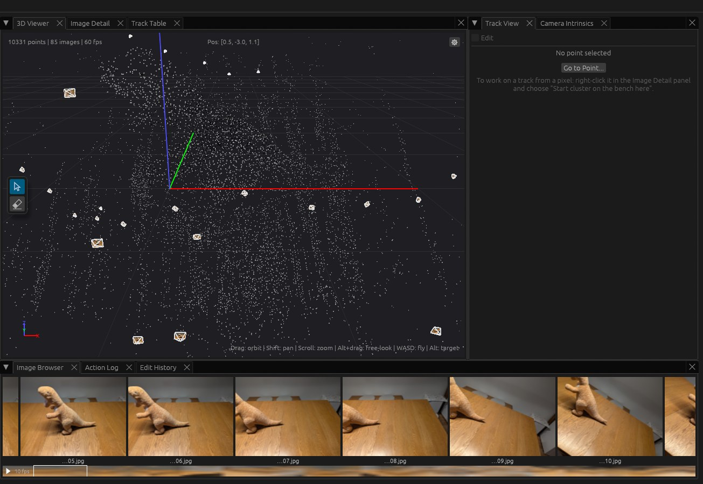

# Getting Started

Make your first 3D reconstruction from a set of photographs and look at it in
SfM Explorer. SfM Tool extracts the SIFT features itself, and uses
[COLMAP](https://colmap.github.io/), run through its Python bindings pycolmap,
to match them and to solve.

The photographs are the
[dino dog toy dataset](https://github.com/sfmtool/sfmtool/tree/main/test-data/images/dino_dog_toy):
85 photographs of a dog toy on a table, taken from different angles. The toy
and the table have enough texture to give many SIFT features.

## 1. Install and get the photographs

```
$ pip install sfmtool
```

SfM Tool needs Python 3.14;
[Installation](../index.md#installation) on the home page lists the platforms
it has wheels for.

These commands download only the dataset's directory of the sfmtool
repository, about 40 MB, and copy the photographs into `dino/images/`. They
need [git](https://git-scm.com/).

```
$ git clone --depth 1 --filter=blob:none --sparse https://github.com/sfmtool/sfmtool
$ git -C sfmtool sparse-checkout set test-data/images/dino_dog_toy
$ mkdir -p dino/images
$ cp sfmtool/test-data/images/dino_dog_toy/*.jpg dino/images/
$ cd dino
```

## 2. Initialize the workspace

A workspace is a directory with its own settings, such as how features are
extracted. Every `sfm` command you run inside it uses those settings.

```
$ sfm ws init --max-features 4000
Initialized workspace: .../dino
...
  feature_prefix_dir: features/sift-sfmtool-321fc2aaf62cc4697adafe94c11e4642
```

The workspace extracts at most 4000 SIFT features from each image, and stores
them under the `feature_prefix_dir` it prints, inside the images directory.

## 3. Solve

The solve extracts the features, matches them across the photographs, and
works out where each camera stood and where the 3D points are.
`--max-features 2000` uses the 2000 largest of each image's 4000 features:
fewer features match faster, and the stored 4000 let a later solve use more
without extracting them again.

```
$ sfm solve -g images/ --max-features 2000
Running global SfM with COLMAP's global mapper...
...
Found reconstruction 0:
  Cameras: 1, Images: 85, Points: 10331
Saved reconstruction to: .../dino/sfmr/20261115-00-solve-dino_dog_toy_1-85.sfmr
Completed in 54.25s
```

The `...` stands for about a hundred lines of feature extraction and COLMAP
log. Its warnings, such as *"Less than 50% of cameras have prior focal
lengths"*, do not mean the solve failed: the last lines say how many images
and points it found and where it saved them. The solve gives slightly
different results each time it runs, so your counts and time will differ, and
so will the date that starts the file name.

## 4. Explore in 3D

Open the file the solve saved in SfM Explorer:

```
$ sfm explorer sfmr/20261115-00-solve-dino_dog_toy_1-85.sfmr
```

On Linux, SfM Explorer needs a Vulkan driver.



## Next steps

- [Viewing 3D Point Tracks](point-tracks.md): follow one 3D point through the
  photographs that see it, and move around the scene in SfM Explorer.
- [Inspecting a Reconstruction](inspecting.md): check a reconstruction from
  the command line.
- [Converting Video to Image Sequences](video-to-images.md): turn a video into
  the images `sfm` works with.
