# Viewing 3D Point Tracks

A point track connects a 3D point to its observations, the places where it
was seen in the photographs. Exploring tracks shows how SfM links features
across photographs. These steps start from the reconstruction made in
[Getting Started](getting-started.md), open in SfM Explorer.

## 1. Convert to embedded patches

Track View measures each observation against a small square of the surface,
the point's patch, and a fresh solve has no patches yet. In the **Scene**
panel, right-click the reconstruction's row, named after its file
(`20260413-00-solve-dino_dog_toy_1-85` in Getting Started's example), and
choose **Convert to Embedded Patches**.

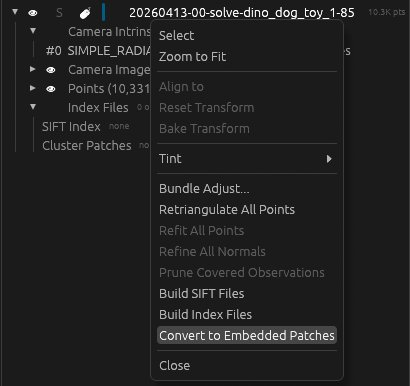

The 3D Viewer's status line reads *Converted
20260413-00-solve-dino_dog_toy_1-85 to embedded patches: … points framed, 85
images read*, the row's name gains a leading `*` for an unsaved change, and a
**Patches** row appears under it.

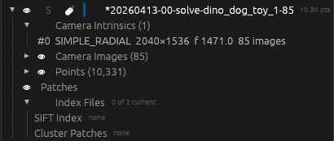

The 3D view draws the patches as small squares of photograph.

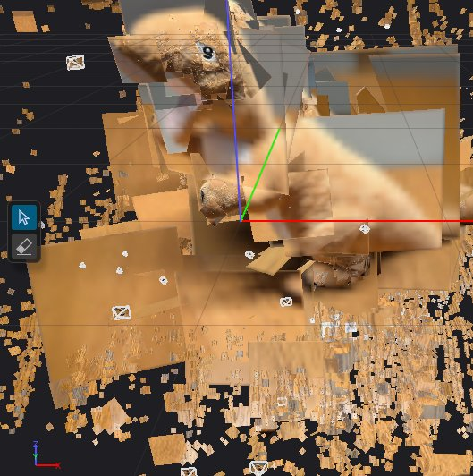

The change is held in the viewer; **File > Save** writes it to the file.

## 2. Put Image Detail beside Track View

In the stock layout, **Image Detail** is a tab behind the **3D Viewer**, and
**Track View** is on the right. Drag the **Image Detail** tab into the middle
of the 3D Viewer; five square drop targets appear there in a cross. Release
it on the right-hand one to split the area.

The 3D Viewer is now on the left, Image Detail in the middle and Track View on
the right.

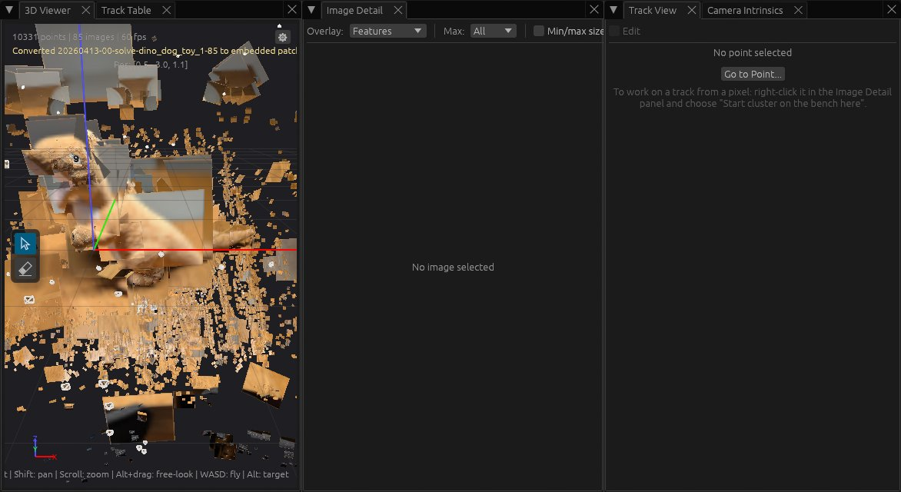

## 3. Look through a photograph

In the **Image Browser** at the bottom, double-click the thumbnail numbered
**2** to select it and look through it. The Image Browser numbers images from
0 and the file names count from 01, so this is `dino_dog_toy_03.jpg` (camera
image 2).

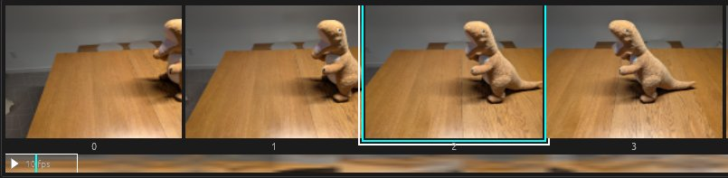

The 3D Viewer's status line reads *Looking through
images/dino_dog_toy_03.jpg*, the 3D view shows the photograph from where its
camera stood, and Image Detail shows the same photograph.

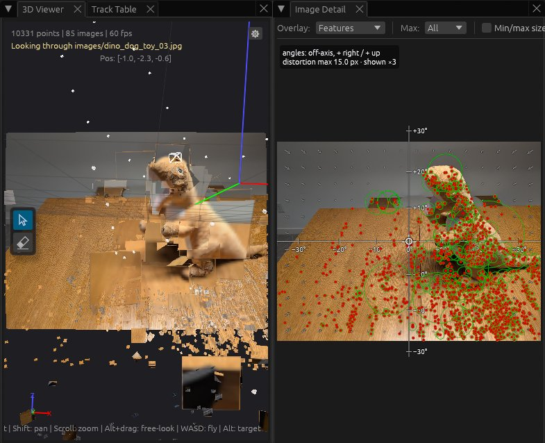

In Image Detail's toolbar, set **Overlay** to **Track Length**. Each feature
with a track becomes a dot coloured by how many observations its track has,
from red for the shortest through yellow to green for the longest, and a
**Track Length** colour bar at the bottom right gives the range.

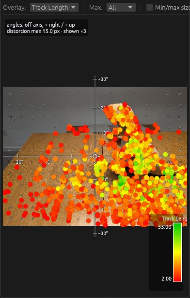

## 4. Select the longest track in the photograph

Click the **Track Table** tab, beside the 3D Viewer tab. Tick **Seen in
selected image**, so that the table lists only the points seen in
`dino_dog_toy_03.jpg`. Click the **Track** heading twice to sort by track
length, longest first (the first click sorts shortest first; after the
second, the heading shows a downward triangle). Click the top row to select
its point.

The row turns blue, and Track View's header shows the point's ID and
*track: N obs*, where N is the number in the row's **Track** cell.

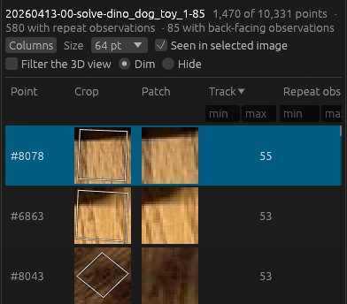

Track View lists one row per observation. Its columns are **Img** (the camera
image index), **Crop** (the photograph around the patch), **Patch** (that
patch drawn square), **Verdict**, **ZNCC** (how closely this photograph's
view of the patch matches the point's stored patch), **Self-similarity**,
**Proj. err** (the reprojection error, in pixels over degrees), **Shift**,
**Zoom**, **Reference**, **Status** and **Name** (the file name); scroll
sideways to see them all.

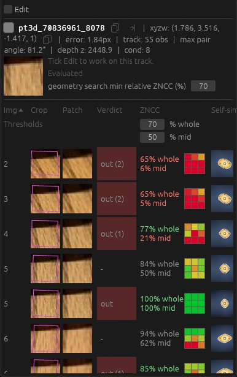

*N obs* counts observations, not photographs. One photograph can hold more
than one observation of the same point, which a GLOMAP solve can produce, so
the same **Img** number can appear on two rows. The Track Table's **Repeat
obs.** column, next to **Track**, counts those extra observations.

## 5. Navigate in camera view

Click the **3D Viewer** tab. It is still looking through camera image 2, and
draws the selected track as lines from the point to each camera that sees it.

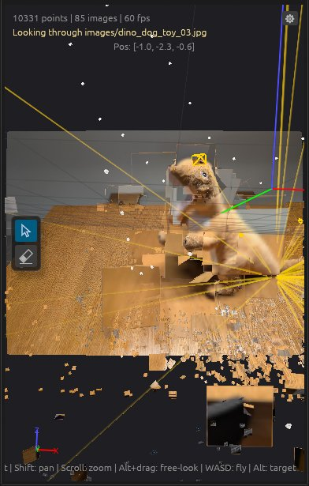

With the pointer over the 3D Viewer:

- **Drag** to look around (free look) from the camera's position.
- **Scroll** (on a trackpad, pinch, or hold Ctrl and drag two fingers) to zoom
  the field of view in and out.
- **`.`** / **`,`** look through the next / previous camera image, keeping
  the direction you turned to.
- **Z** looks straight through the selected camera image.
- **Click** a camera frustum to select its camera image, which shows it in
  Image Detail; **double-click** it to look through it.

These keep camera view: the status line reads *Looking through …* after a
double-click or Z, and *Selected image …* after `.`, `,` or a click.

## 6. Navigate freely

Hold Shift and drag (on a trackpad, hold Shift and drag two fingers) to pan.
A pan moves the camera, so it leaves camera view, and the photograph behind
the points disappears. A plain drag now orbits around the target, a point in
front of the camera, and scrolling moves toward or away from it. With the
pointer over the 3D Viewer, these keys fly through the scene:

- **W / S**: fly forward / back
- **A / D**: fly left / right
- **R / F**: fly up / down
- **Q / E**: tilt the horizon left / right. This turns **Maintain Z-up** off
  (in the **Camera** section of the 3D Viewer's **Display** box), and the
  status line reads *Maintain Z-up off*.
- **Home**: level the horizon (*Levelled the horizon*); **Shift+Home** resets
  the view.
- **Z**: zoom to fit all the points, or, while a camera image is selected,
  look through it.

Orbit and fly until the track's lines all show, as in this screenshot.

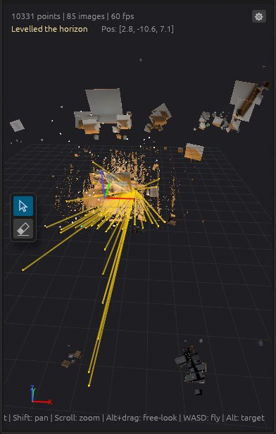

## 7. Move the target

Hold Alt and drag to look around from where the camera stands: the target
moves around the camera instead of the camera around the target. While Alt is
held the target is drawn as a compass, with a spike pointing up. Alt+click
sets the target to the point under the pointer and selects that point, and
Alt+scroll pushes the target away or pulls it closer.

To keep the target shown, open the **Display** box at the top right of the
3D Viewer (click its gear if it is closed) and tick **Target indicator** under
**Layers**. The status line reads *Target indicator on*.

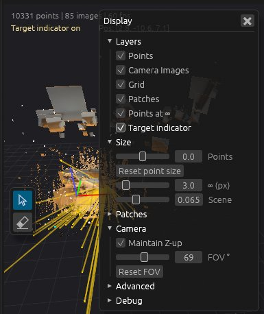

The compass stays drawn without Alt.

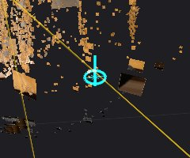

Orbiting turns around the compass's up spike. If the table looks tilted
against the compass, press Q or E to tilt the horizon until the compass lies
flat on the table; orbiting is then more comfortable.
