# Viewing 3D Point Tracks

A point track connects a 3D point to its observations, the places where it
was seen in the photographs. Exploring tracks shows how SfM links features
across photographs. These steps start from the reconstruction made in
[Getting Started](getting-started.md). Have it open in SfM Explorer.

## 1. Convert to embedded patches

Track View measures each observation against the point's patch, a small
square of the surface. A fresh solve has no patches yet. In the **Scene**
panel, right-click the reconstruction's row and choose **Convert to Embedded
Patches**. The row is named after its file:
`20261115-00-solve-dino_dog_toy_1-85` in the run these screenshots come from.

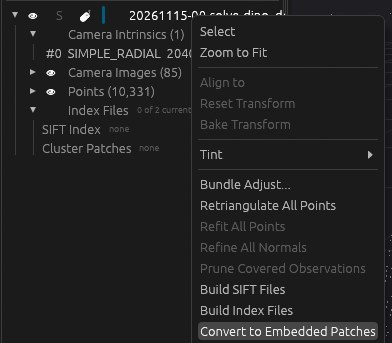

The row's name gains a leading `*`, which marks an unsaved change. A **Style**
line with **Dots** and **Patches** appears under the **Points** row. Click
**Patches** to draw each point as its patch.

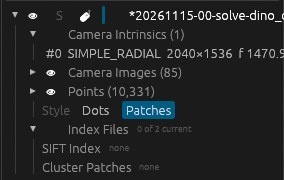

The 3D view draws the points as small squares of photograph.

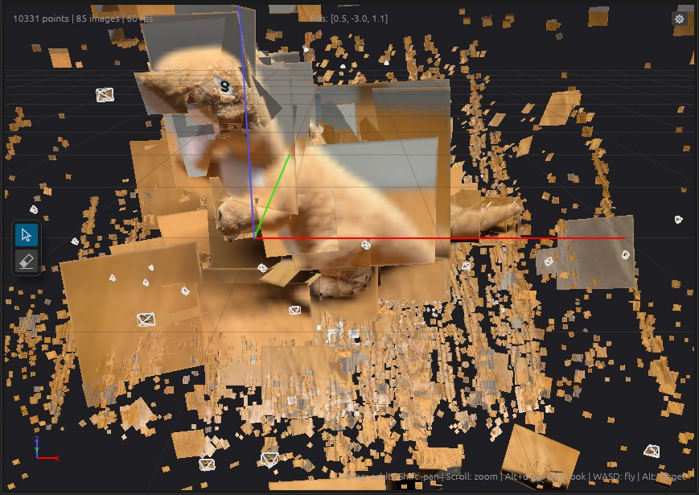

The change is held in the viewer until **File > Save** writes it to the file.

## 2. Put Image Detail beside Track View

In the stock layout, **Image Detail** is a tab behind the **3D Viewer**, and
**Track View** is on the right. Drag the **Image Detail** tab into the middle
of the 3D Viewer. Five square drop targets appear there in a cross. Release
the tab on the right-hand one to split the area.

The 3D Viewer is now on the left, Image Detail in the middle and Track View on
the right.

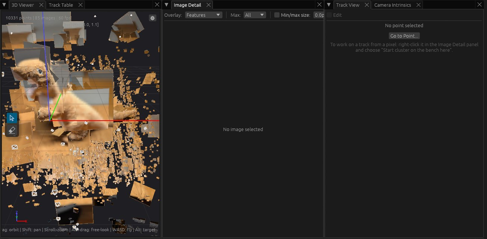

## 3. Look through a photograph

In the **Image Browser** at the bottom, double-click the thumbnail labelled
`…03.jpg` to select it and look through it. That is `dino_dog_toy_03.jpg`,
camera image 2.

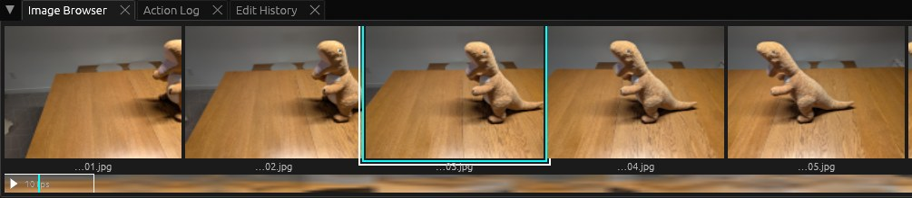

The 3D Viewer's status line reads *Looking through
images/dino_dog_toy_03.jpg*, and Image Detail shows the same photograph.

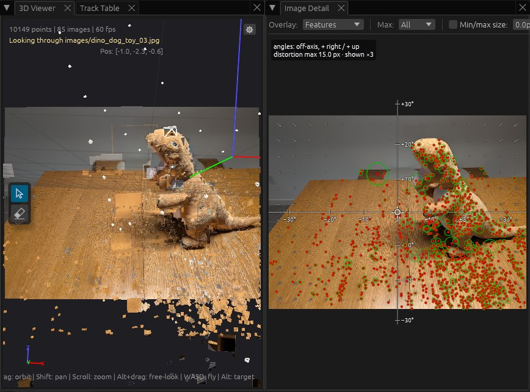

In Image Detail's toolbar, set **Overlay** to **Track Length**. Each feature
with a track becomes a dot coloured by its track's length, from red for the
shortest to green for the longest. A **Track Length** colour bar appears at
the bottom right.

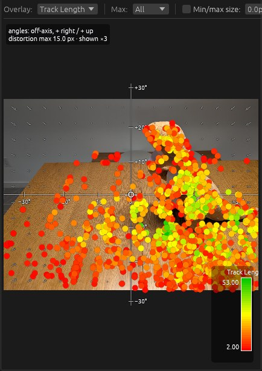

## 4. Select the longest track in the photograph

Click the **Track Table** tab, beside the 3D Viewer tab. Tick **Seen in
selected image**, so that the table lists only the points seen in
`dino_dog_toy_03.jpg`. Click the **Track** heading twice to sort by track
length, longest first. After the second click, the heading shows a downward
triangle. Click the top row to select its point.

The row turns blue. Track View's header shows *track: N obs*, where N is the
number in the row's **Track** cell.

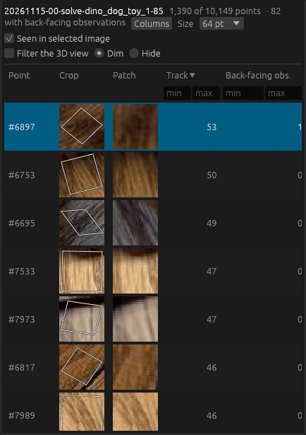

Track View lists one row for each photograph that sees the point. **Img** is
the camera image index, **Crop** the photograph around the point, and
**Patch** the point's patch as that photograph sees it. sfmtool's
[`track-view.md`](https://github.com/sfmtool/sfmtool/blob/main/specs/gui/track-view.md)
says what the other columns measure.

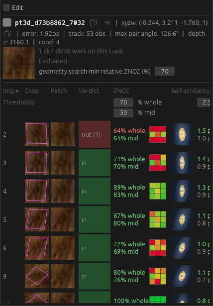

## 5. Navigate in camera view

Click the **3D Viewer** tab. It is still looking through camera image 2. It
draws the selected track as lines from the point to each camera that sees it.

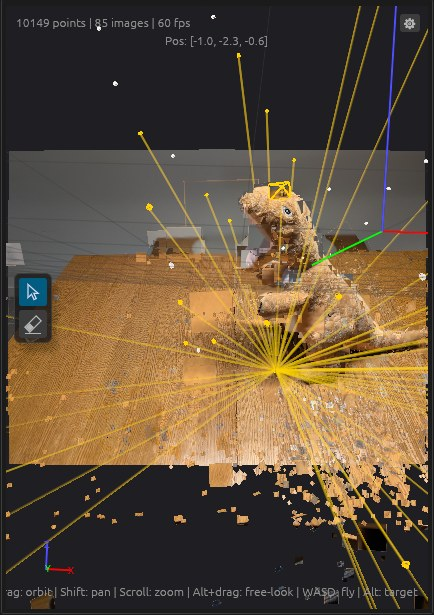

With the pointer over the 3D Viewer:

- **Drag** to look around (free look) from the camera's position.
- **Scroll** to zoom the field of view in and out. On a trackpad, pinch, or
  hold Ctrl and drag two fingers.
- **`.`** / **`,`** look through the next / previous camera image, keeping
  the direction you turned to.
- **Z** looks straight through the selected camera image.
- **Click** a camera frustum to select its camera image and show it in Image
  Detail. **Double-click** a frustum to look through its camera image.

These keep camera view. The status line reads *Looking through …* after a
double-click or Z, and *Selected image …* after `.`, `,` or a click.

## 6. Navigate freely

Hold Shift and drag to pan. On a trackpad, hold Shift and drag two fingers.
A pan moves the camera and leaves camera view. The photograph behind the
points disappears. A plain drag now orbits around the target, which is a point
in front of the camera. Scrolling moves toward or away from the target. With the
pointer over the 3D Viewer, these keys fly through the scene:

- **W / S**: fly forward / back
- **A / D**: fly left / right
- **R / F**: fly up / down
- **Q / E**: tilt the horizon left / right. This turns off **Maintain Z-up**,
  in the **Camera** section of the 3D Viewer's **Display** box. The status
  line reads *Maintain Z-up off*.
- **Home**: level the horizon; the status line reads *Levelled the horizon*.
  **Shift+Home** resets the view.
- **Z**: zoom to fit all the points. While a camera image is selected, Z
  looks through it instead.

Orbit and fly until the track's lines all show, as in this screenshot.

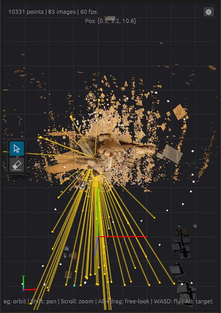

## 7. Move the target

Hold Alt and drag to look around from where the camera stands. The target
moves around the camera, instead of the camera moving around the target. While
Alt is held, the target is drawn as a compass, with a spike pointing up.
Alt+click sets the target to the point under the pointer and selects that
point. Alt+scroll pushes the target away or pulls it closer.

To keep the target shown, tick **Target indicator** under **Layers** in the
**Display** box, at the top right of the 3D Viewer. If the box is closed,
click its gear to open it. The status line reads *Target indicator on*.

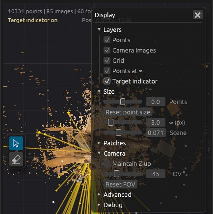

The compass stays drawn without Alt.

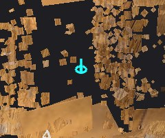

Orbiting turns around the compass's up spike. If the table looks tilted
against the compass, press Q or E until the compass lies flat on the table.

## Next steps

- [Inspecting a Reconstruction](inspecting.md): check a reconstruction from
  the command line, and find the images and parts of the camera path to look
  at here.
